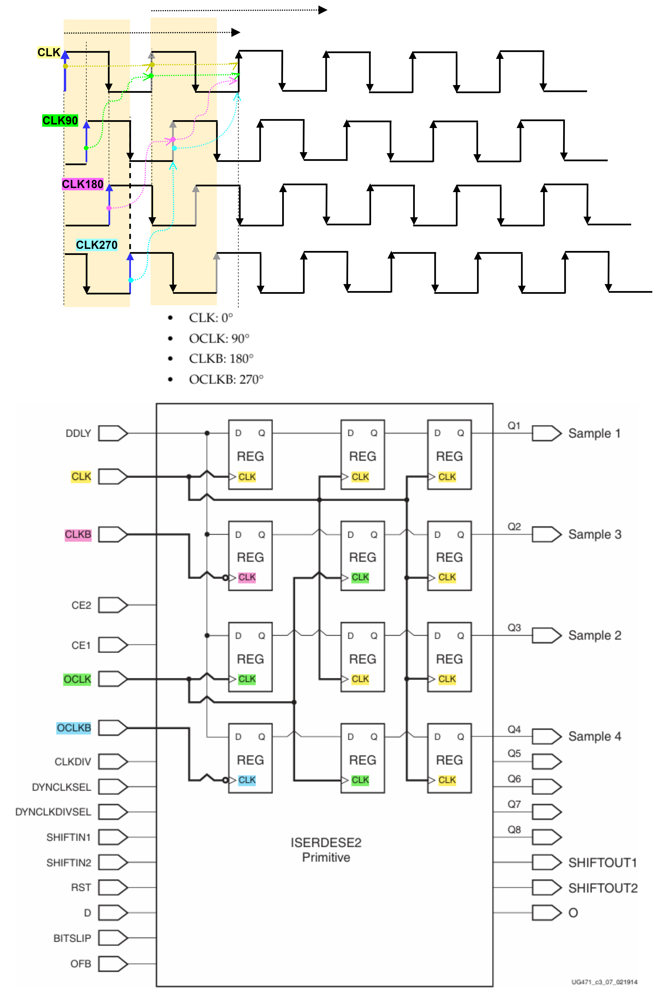
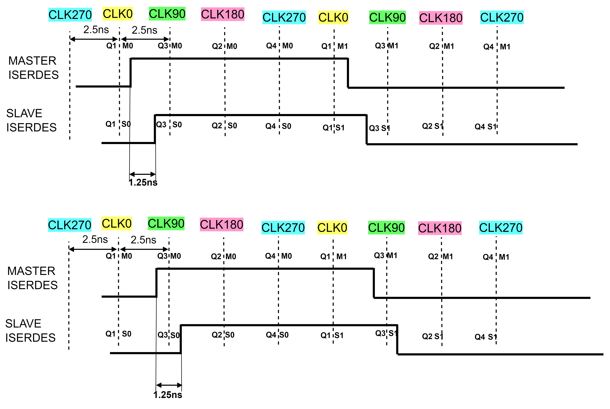
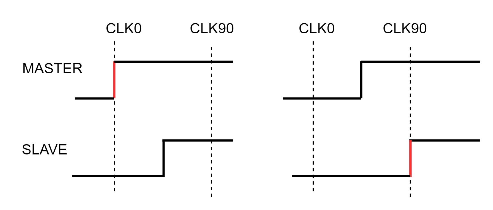
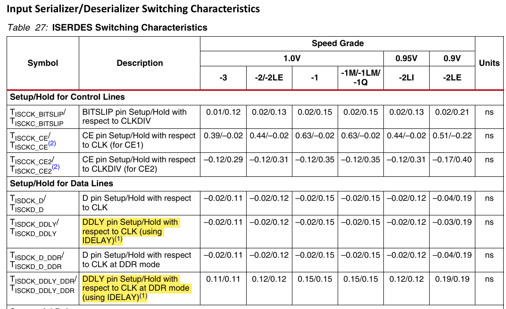
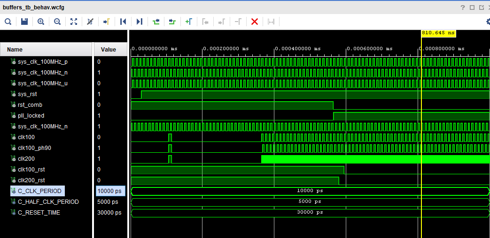
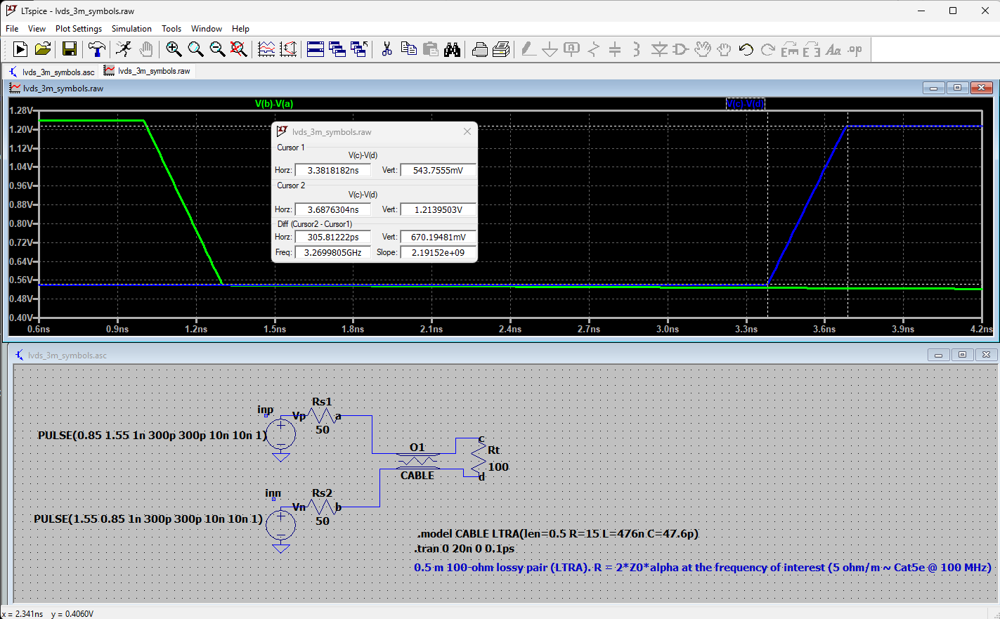
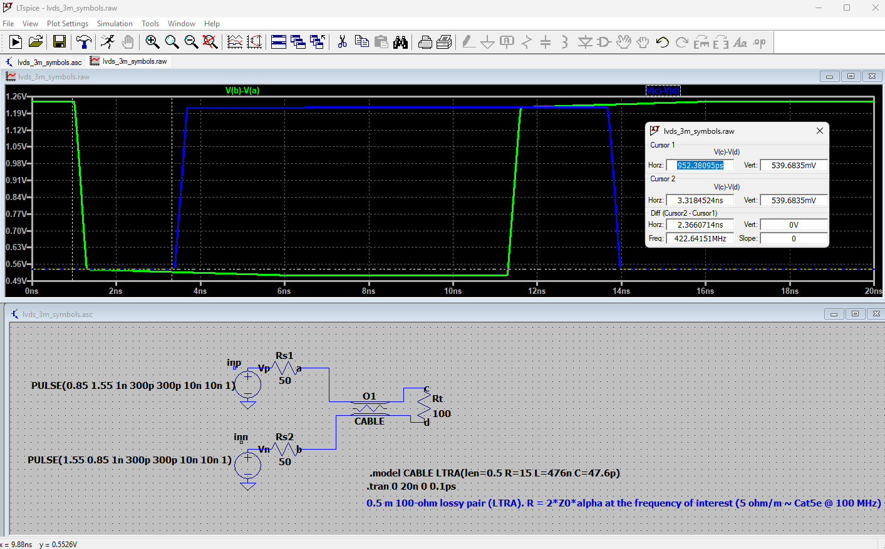

# Detection of 10ns Pulse Rise Time by Oversampling (2.5ns resolution).

## 1. Problem definition

Suppose there are two separate FPGA cards, each work with 100MHz clock.
* A 10ns wide pulse is transmitted from one FPGA card to another via LVDS buffers. 
* The transmitted pulse passes over 0.5m twisted pair cable (with $Z_0=100 Ω$ and 100 Ω termination). There exists ground connection between the two cards to prevent common mode voltage difference.  
* We need to measure the **time of pulse rise** in the second FPGA with high accuracy. 

In this project I show that it is possible to measure the rise time of pulse with 2.5ns resolution.

Notes: 
- the solution is based on **[xapp881](https://docs.amd.com/v/u/en-US/xapp881_V6_4X_Asynch_OverSampling)**.

- The 0.5 m cable contributes delay of about 2.5ns (5ns/meter), and causes a slight encrease in the pulse rise time because of high frequency losses in transmission line, but they can be neglected for 0.5 meter cable length. The LVDS signal pulse rise time is about 300ps at both sides of the cable, but after IBUFDS the FPGA logic sees a clean pulse rise.   

## 2. Solution explanation.

### 2.1. ISERDES operation in oversampling mode.

ISERDES logic in the oversampling mode  is described in **[UG471](https://docs.amd.com/v/u/en-US/ug471_7Series_SelectIO)**, see the picture below. 
Note that the purpose of inverted clk input of CLKB and OCLKB Flip Flops in the below picture is to show only that CLKB and OCLKB inputs are inverted relative to CLK and OCLK. All FF's in ISERDES in oversampling mode are sampling their data at rising clock edge. 

At every rising edge of CLK we get sampled DDLY data input values **at 4 different times**, all of them occured **<u>during previous CLK period</u>** : 
- Q1 (Sample1): sampled data at CLK rising edge (at $0^o$), during previous CLK period. 
- Q**3** (<mark>Sample2</mark>): sampled data at OCLK rising edge (at $90^o$) during previous CLK period.
- Q**2** (<mark>Sample3</mark>): sampled data at CLKB rising edge (at $180^o$) during previous CLK period
- Q4 (Sample4): sampled data at OCLKB rising edge (at $270^o$) during previous CLK period.    

### 2.2. Using of two ISERDES blocks in oversampling mode.
In every I/O tile there are two ISERDES modules; one master and one slave. We will use each module separetly without connection between them.

Similar to **[xapp881](https://docs.amd.com/v/u/en-US/xapp881_V6_4X_Asynch_OverSampling)** :
- Pass the data input after IDELAY block with shift of $0^o$ to master ISERDES.
- Copy the same data input shifted by $45^o$ to slave ISERDES.
- Each ISERDES block will sample data with clock of 100MHz and the same clock shifted by $90^o$. 
- Also each ISERDES will get the inverted version of the above clocks. 

To shift the pulse by $45^o$ (1.25ns) we will use IDELAY block, and  IDELAYCTRL block with 200MHz clock. this will get tap size of 78ps, so we need 16 taps to get 1.25ns delay.  

I will mark each sampled output similar to [xapp881](https://docs.amd.com/v/u/en-US/xapp881_V6_4X_Asynch_OverSampling):
"QxMy" for master ISERDES outputs:
* "Qx" is **master** ISERDES output number (x = 1...4)  
* "My" - M for "master", y is clock edge number.  

"QxSy" for slave ISERDES outputs: 
* "Qx" is **slave** ISERDES output number (x = 1...4)
* "Sy" - S for "slave",  y is clock edge number.

<mark>**The key idea:**</mark>
 ***A 45° phase shift between master and slave ISERDES data guarantees that at least one rising data edge will be sampled correctly by either the Master or Slave ISERDES. Even if one of the sampling edges (Master or Slave ISERDES) occurs too close to a data transition and violates setup/hold timing, the other sampling edge will be sufficiently far from the transition to capture the data reliably.*** 

 We detect the rising edge by verify that first sampled value is "0" and adjucent sampled value at $90^o$ is "1". 
 
 - To detect pulse rising edge of master or slave data:
   - When data rising edge is between CLK0 and CLK90: 
      ((Q1M0 = '0') and (Q3M0 = '1')) or ((Q1S0 = '0') and (Q3S0 = '1'))
   - When data rising edge is between CLK90 and CLK180: 
      ((Q3M0 = '0') and (Q2M0 = '1')) or ((Q3S0 = '0') and (Q2S0 = '1'))
   - When data rising edge is between CLK180 and CLK270: 
      ((Q2M0 = '0') and (Q4M0 = '1')) or ((Q2S0 = '0') and (Q4S0 = '1'))
   - When data rising edge is between CLK270 and CLK0 of next clock period: 
      ((Q4M0 = '0') and (Q1M1 = '1')) or ((Q4S0 = '0') and (Q1S1 = '1'))

  There can be several cases: 
  - Both slave and master data rising edges satisfy timing requirements (setup/hold).
   In this case the rising edges of master and slave data will be samled or in the same $90^o$ interval or in adjucent $90^o$ clock intervals (first will be detected master rising data edge and after it rising data edge.):

- One of rising edges (in slave or master data) is too close to clock rise and does not satisfy timing requirements. 
In this case the problematic rising data edge will contribute "1" or "0", depending on clk/data jitter and/or metastability release conditions.
Metastability can also pass to next pipeline register stages within ISERDES because of short release time option in FFs that work on different clock edges. In any case, we will insert syncronization stage of two registers <u>after</u> ISERDES output, before analyzing its outputs.
In any case, rising edge of data will or cause to its detection, or cause to late detection, or not cause to detection at all.
In this case the second rising edge will be detected always sucessfully, because it satisfies the timing requirements.     

To verify that shift of 1.25 ns between master and slave data is anough to garantee that one of them will be sampled sucessfully, below presented setup/hold requirements for data detection within ISERDES block (see **[ds182](https://docs.amd.com/v/u/en-US/ds182_Kintex_7_Data_Sheet))**:  

### 2.3. The solution microarchitecture.

To register pulse rising edge event time, the design will use 64 bit timer based on 100Mhz clock.
The design will detect first data rising edge either in master of slave channel, based on adjucent $90^o$ shifted clocks in each channel.   
The pulse detected on some risnig edge of 100MHz clock will lock 64bit counter value. The pipeline latency of 4 (2 for ISERDES module plus 2 for syncronizer) will be substracted from it to the pulse time at IDELAY block enter. Additional 2 bit register **sub_period_time** will define the exact position of rising edge within the clock period between different phase boundaries: 

|pulse rise event|sub_period_time value|
|:---|:---:|
|between $0^o$ and $90^o$ |00|
|between $90^o$ and $180^o$ |01|
|between $180^o$ and $270^o$ |10|
|between $270^o$ and $0^o$ |11|

The solution's microarchitecture: 

## 3. Simulation results.

Simulation of buffers block, that includes includes buffers, PLL and reset synchronizers: 

## 4. Cable propagation delay and pulse rise time at receiver.

LVDS cable propogation delay : ~5 ns/m (varies from ~4.5 to 5.5 ns/m depending on cable, while in vacuum it is about 3.3 ns/m). So the propogation delay in 0.5m cable is: 
$$ 5\frac {ns}{m}\cdot0.5m = 2.5ns $$

If the pulse is Gaussian its BW is roughly : 
$$f\approx \frac {0.35}{t_r}$$

If the pulse has sharper rolloff, the BW can be about (coservative SI rule of thumb): 
$$f\approx \frac {0.5}{t_r}$$

Rise/Fall times for Kintex FPGA : 

| I/O standard | Bank | Setting | Typical rise/fall |
|---|---|---|---|
| LVCMOS33 / LVCMOS25 | HR | SLEW=FAST, 12–16 mA | ~0.7–1.5 ns |
| LVCMOS33 / LVCMOS25 | HR | SLEW=SLOW | ~2–4 ns |
| LVCMOS18 | HP | FAST | ~0.5–1 ns |
| LVCMOS18 | HP | SLOW | ~1.5–3 ns |
| SSTL15 (DDR3) | HP | FAST | ~0.3–0.6 ns |
| <mark>LVDS / LVDS_25 | HP / HR | n/a | <mark>~200–400 ps |
| GTX transceivers | dedicated | n/a | ~30–50 ps (multi-Gb/s class) |

So for LVDS signal the spectral contents is about : 

$$f\approx \frac {0.5}{300\cdot{10^{-12}[s]}}=1.6Ghz$$

### 3.1. LTSPICE simulation of pulse transmittion.

Build LTSpice model of transmittion line with help of Claude AI: 

How the parameters were chosen. 
These are per-meter values for a 100 Ω pair with velocity about $0.7c$ ($c \approx 3\times10^8\,\text{m/s}$ is the speed of light in vacuum, and $0.7$ is the cable’s velocity factor.):

$$Z_0=\sqrt{L/C}=100\,\Omega,\qquad v=\frac{1}{\sqrt{LC}}\approx 2.1\times10^8\,\text{m/s}$$

which gives $L \approx 476\,\text{nH/m}$ and $C \approx 47.6\,\text{pF/m}$.

---
<u>Explanation of L and C calculation:</u>

$$Z_0 = \sqrt{\frac{L}{C}}, \qquad v = \frac{1}{\sqrt{LC}}$$

Multiplying and dividing them gives:

$$
Z_0 \cdot v = \sqrt{\frac{L}{C}}\cdot\frac{1}{\sqrt{LC}} = \frac{1}{C}
\quad\Rightarrow\quad
C = \frac{1}{Z_0\,v}
$$
$$
\frac{Z_0}{v} = \sqrt{\frac{L}{C}}\cdot\sqrt{LC} = L
\quad\Rightarrow\quad
L = \frac{Z_0}{v}
$$

With $Z_0 = 100\,\Omega$ (differential) and $v = 0.7c = 2.1\times10^8\,\text{m/s}$:

$$L = \frac{100}{2.1\times10^8} \approx 476\,\text{nH/m}$$
$$C = \frac{1}{100 \times 2.1\times10^8} \approx 47.6\,\text{pF/m}$$

---

R as an effective loss at one frequency. LTRA has no skin effect, so R is set to match the cable’s loss at the frequency you care about:

$$\alpha\,[\text{Np/m}] \approx \frac{R}{2Z_0}\;\Rightarrow\; R = 2Z_0\,\alpha$$

For Cat5e at 100 MHz, the loss is 0.22 dB/m = 0.0253 Np/m, so $R \approx 5\,\Omega/\text{m}$. For a knee frequency near 1 GHz, try $R \approx 15$–$20\,\Omega/\text{m}$.

Limitations to keep in mind:

This models the differential mode only. Common-mode effects and intra-pair skew are ignored.
Constant R makes edges look somewhat too clean or too dirty at frequencies far from the one you tuned it for. For frequency-accurate loss, use PyBERT or an S-parameter model.

The results of LTSPICE simulation: 

* The rise time at receiver: about 305 ps for R=15 Ohm

* The delay is about 2.3ns:

